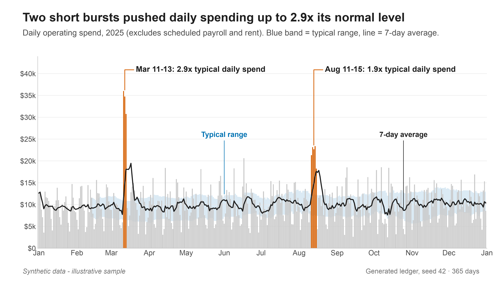

# Transaction patterns: three example charts

**Live page:** https://veridius-code.github.io/transaction-viz-showcase/

> **Synthetic data - illustrative sample.** Every transaction in this repository was generated by
> `src/generate_data.py` (seed 42) to look like a typical company ledger. No real company or client
> data is used. Three anomalies were planted on purpose so the method can be checked against a
> known answer.

This repo turns 12 months of transaction records into three executive-ready charts:

| | Chart | Question it answers |
|---|---|---|
| 1 | **Spending velocity vs baseline** | How fast is money going out compared with normal, and when did it break away? |
| 2 | **Cash flow pattern** | How does the cash position move week to week, and what pushes it negative? |
| 3 | **Flagged periods vs normal periods** | Is a multi-day spike really unusual, or just a busy week? |

Each chart comes in two forms:

- a static version for reports: PNG at 300 dpi plus a vector PDF, 13.33 × 7.5 in, in `outputs/`;
- an interactive Plotly version on the page in `docs/`.

The notebook `notebook/analysis.ipynb` walks through the full pipeline.



## Run it

Requires Python 3.11 or newer.

```bash
make setup     # creates .venv and installs the pinned requirements (uses uv if available)
make build     # data -> robustness check -> tests -> charts -> notebook -> site
open docs/index.html
```

You can also run each step on its own: `make data`, `make test`, `make charts`, `make notebook`, `make site`.

## Layout

```
src/
  generate_data.py   synthetic ledger + messy raw export + planted anomalies
  clean.py           cleaning, with a log of every fix
  analysis.py        daily series, robust baseline, cluster detection, window comparison
  narrative.py       chart titles and plain-language insights, computed from the results
  charts_static.py   matplotlib PNG/PDF charts
  charts_interactive.py  Plotly charts for the page
  build_site.py      writes docs/ (Plotly.js bundled locally, so it works from file://)
  robustness.py      re-runs detection on 30 other random seeds
tests/               pytest: cleaning matches ground truth; detector recovers the planted anomalies
notebook/            analysis.ipynb (generated by build_notebook.py, executed by make)
data/                transactions_raw.csv, transactions_clean_truth.csv, planted_anomalies.json
outputs/png, pdf/    report-ready charts
docs/                the static site deployed to GitHub Pages
```

## Method

- **Cleaning.** The raw export is deliberately messy:
  - mixed date formats;
  - amounts as text (`"$1,234.50"`, signed values);
  - duplicated transaction IDs;
  - blank categories;
  - inconsistent casing and direction labels.

  Each fix is logged with a row count. The cleaned data matches the generator's ground truth exactly, and a test checks this.
- **What is scored.** Detection uses operating spend, which excludes scheduled payroll and rent because those are known in advance. Cash flow (chart 2) includes everything.
- **Baseline.** Each day is adjusted for its weekday. The baseline is the rolling median of the previous 28 days. The spread is the median absolute deviation (MAD) × 1.4826 of the deviations from that baseline, taken over the previous 56 days so it stays stable. Weekends are also noisier than weekdays, so z-scores are put on a common scale for each weekday. Days inside a detected cluster are removed and the baseline is recalculated, so clusters do not contaminate their own baseline.
- **Cluster rule.** A cluster is a run of 2 or more consecutive days with robust z > 2.5 for spending. An inflow drought is the same rule with z < -2.5. All of these settings are in `DetectionConfig`.
- **Comparison.** For a cluster of length *L*, every other *L*-day window that doesn't touch a cluster forms the reference distribution. The output has three parts:
  - the x-fold multiple of the median window;
  - the share of normal windows the cluster exceeds, which is a descriptive percentile and not a p-value;
  - a 95% bootstrap interval for the cluster's mean per day (5,000 resamples).
- **Robustness.** On 30 regenerated years with different random noise, the detector found 89 of 90 planted anomalies. 80 of them had start and end dates within one day. There were 5 false clusters in total across the 30 years. The published sample recovers all three exactly, with no false clusters.

### Limitations

- The data is synthetic. Real ledgers have quarter-ends, bank holidays, reversals and other quirks.
- The baseline needs about four weeks of history, so early January is not scored.
- Short clusters give rough bootstrap intervals.
- Overlapping windows are not independent, which is another reason the percentiles are descriptive only.
- A flag means "look here", not "something is wrong".

## Deployment

`.github/workflows/pages.yml` runs on every push to `main`. It runs the tests and the full build, then deploys `docs/` with `actions/upload-pages-artifact` and `actions/deploy-pages`.

---

Raul Ungureanu, Data Scientist · [github.com/veridius-code](https://github.com/veridius-code)
